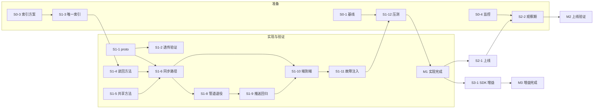

# 消息发送链路一致性改造开发计划

依据 [msg-send-sync-commit.md](msg-send-sync-commit.md)（下称设计文档）拆解的开发计划。项目处于开发阶段、无线上存量流量，发送管道一次性切换，不设灰度与双路径机制；里程碑以退出标准界定，不含工期估算，串并行安排由第 7 节依赖图驱动。

---

## 一、计划概览

| 里程碑 | 内容 | 退出标准（摘要） |
|---|---|---|
| M0 准备就绪 | 压测基线、容量评估、索引方案、监控就绪 | Q1/Q2 关闭，监控面板可用 |
| M1 实现完成 | 阶段一全部任务合入主干 | 全量测试与故障演练通过，压测达标 |
| M2 上线验证 | 部署上线并完成观察期 | 观察期指标达标（验收矩阵 V6） |
| M3 增益完成 | SDK 增益与对账任务（可选范围确认后执行） | Q4 决议项关闭 |

---

## 二、阶段零：准备与基线（对应里程碑 M0）

| 任务 | 内容 | 产出 | 关联 |
|---|---|---|---|
| S0-1 | 开发环境全链路压测，采集 1003 ack P99 / 错误率基线，作为 7.1 验收阈值（增幅 ≤ 20%）的输入 | 压测基线报告 | Q3 |
| S0-2 | 评估目标发送 QPS 与 Mongo 写能力（副本集/分片写上限、慢查询水位） | 容量评估结论 | Q1 |
| S0-3 | 确认测试库消息集合规模，确定唯一索引创建方式（量级小直接创建；已有大规模数据则评估窗口） | 索引方案 | Q2 |
| S0-4 | 搭建 seq 空洞差值监控（allocator allocated 水位 − Mongo maxSeq）与重登录同步完整率埋点 | 监控面板与告警规则 | 7.3 |

阶段零与阶段一编码可并行；S0-1 结论用于 M1 压测对比，S0-2、S0-3 需在 M1 前关闭，S0-4 需在 M2 前就绪。

---

## 三、阶段一：服务端实现（对应里程碑 M1）

### W1 协议与契约

| 任务 | 内容 | 产出 | 依赖 |
|---|---|---|---|
| S1-1 | `UserSendMsgResp` 增加 seq(4)、conversationID(5) 字段，重新生成 pb | proto 变更 + 生成代码 | 无 |
| S1-2 | 验证网关对 SendMsg 错误的透传行为：RPC 返回 90002 时 1003 errCode 非 0，SDK 能收到失败 | 透传验证记录；如需改动补 im-msggateway 任务 | S1-1 |

### W2 存储准备

| 任务 | 内容 | 产出 | 依赖 |
|---|---|---|---|
| S1-3 | 建立 (conversationID, clientMsgID) 唯一索引（方式按 S0-3 结论） | 索引创建完成 | S0-3 |
| S1-4 | MsgModel 增加按幂等键读回方法与 E11000 冲突判定 | 存储层代码 + 单测 | S1-3 |

### W3 msg.rpc 同步路径

| 任务 | 内容 | 产出 | 依赖 |
|---|---|---|---|
| S1-5 | 从 AddMsgs 抽取共享持久化方法：首条建会话（幂等）、BatchInsert、SetConversationMaxSeq、sender ReadSeq；AddMsgs 行为保持不变（回归验证，通知路径继续使用） | 重构提交 + AddMsgs 回归通过 | 无 |
| S1-6 | SendMsg 同步路径：seq 幂等分配 → 落库（冲突读回）→ 建会话 → maxSeq → ReadSeq → 投递 push topic（携带 seq）→ resp 填充 seq/conversationID | 发送路径代码 | S1-1、S1-4、S1-5 |
| S1-7 | 幂等与失败语义单测：重复 clientMsgID 返回相同 seq；并发重试无重复落库；Mongo 故障返回 90002 | 单测套件 | S1-6 |

### W4 msgtransfer 简化

| 任务 | 内容 | 产出 | 依赖 |
|---|---|---|---|
| S1-8 | 用户消息管道退役：下线用户消息的 allocateMsgSeq、攒批、to-mongo-topic、持久化消费；通知路径保留原逻辑 | msgtransfer 简化提交 | S1-6 |
| S1-9 | im-push / 网关对带 seq 消息的 2001 下发回归 | 回归通过记录 | S1-8 |

### W5 测试与演练

| 任务 | 内容 | 产出 | 依赖 |
|---|---|---|---|
| S1-10 | 端到端用例（对应验收矩阵 V1~V4）：发送 → ack → 立即 GetMaxSeq + Pull 完整；首条消息新会话可见；发送后立刻重登录同步完整；重复发送返回相同 seq | 集成测试套件 | S1-6、S1-8 |
| S1-11 | 故障注入（V2）：Mongo 停写 / 慢查询 → SDK 收到显式失败并可重发；通知路径消费失败不影响已 ack 用户消息 | 演练报告 | S1-10 |
| S1-12 | 压测（V5）：同会话并发发送、跨会话混合负载，对比 S0-1 基线 | 压测报告（P99 增幅结论） | S1-10、S0-1 |

M1 退出标准：S1-1 ~ S1-12 全部完成合入，压测达标（V5）。

---

## 四、阶段二：上线与验证（对应里程碑 M2）

| 任务 | 内容 | 产出 | 依赖 |
|---|---|---|---|
| S2-1 | 部署上线：唯一索引先行（见设计文档 8.3），随后服务端二进制 | 上线记录 | M1 |
| S2-2 | 观察期复核：seq 空洞差值、重登录同步完整率、ack P99 对照验收矩阵 V6 | 观察报告 | S2-1、S0-4 |

M2 退出标准：观察期内 V6 指标达标。

---

## 五、阶段三：SDK 增益与对账（对应里程碑 M3）

| 任务 | 内容 | 产出 | 依赖 |
|---|---|---|---|
| S3-1 | SDK 记录 ack.seq，2001 推送与本地消息按 (conversationID, seq) 去重排序 | 各端 SDK 变更 | Q4 决议 |
| S3-2 | SDK 空洞容忍约定：补拉某 seq 连续 N 次为空视为已删（N 与服务端监控口径对齐） | SDK 约定文档 + 实现 | S3-1 |
| S3-3 | （可选）im-cron 对账任务：allocated 水位与 maxSeq 差值持续增长时告警并支持人工核查 | cron 任务 | S0-4 |

M3 退出标准：Q4 决议范围内任务完成并发布。

---

## 六、验收矩阵

验收项与设计文档 G1~G4 目标一一对应，V1~V5 在 M1 交付前完成，V6 在 M2 观察期复核：

| 编号 | 验收项 | 方法 | 通过标准 |
|---|---|---|---|
| V1 | ack ⇒ 可查（G1） | 自动化用例：发送收到 ack 后立即 GetMaxSeq + Pull，断言消息返回 | 100% 用例通过，含首条消息新会话场景 |
| V2 | 失败显式化（G2） | 故障注入：Mongo 停写期间发送 | SDK 收到 errCode 非 0（90002），恢复后重发成功且无重复落库 |
| V3 | 推送后置（G3） | 用例断言落库日志先于 push 投递；2001 携带 seq 可立即补拉成功 | 断言全部通过 |
| V4 | ack 携带 seq（G4） | 协议用例 + SDK 用例 | resp 含 seq、conversationID；重复发送返回相同 seq |
| V5 | 性能 | S1-12 压测 | ack P99 增幅 ≤ 基线 20%（设计文档 7.1） |
| V6 | 一致性 | S0-4 面板：重登录同步完整率 | 达到设定阈值；空洞差值无持续增长 |

---

## 七、依赖关系

图 7-1 任务依赖。关键路径：S1-1/S1-5 → S1-6 → S1-8/S1-10 → S1-12 → M1；S0-2（容量结论）不阻塞编码，需在 M1 前关闭。

---

## 八、开放问题跟踪

| 编号 | 问题 | 承担任务 | 关闭节点 |
|---|---|---|---|
| Q1 | 目标发送 QPS 与 Mongo 写能力基准 | S0-2 | M1 前 |
| Q2 | 测试库集合规模与索引创建方式 | S0-3 | S1-3 前 |
| Q3 | 延迟估算压测校准 | S0-1、S1-12 | M1 前 |
| Q4 | SDK 是否同步利用 ack.seq | 产品决策 → S3-1 | M3 前 |
