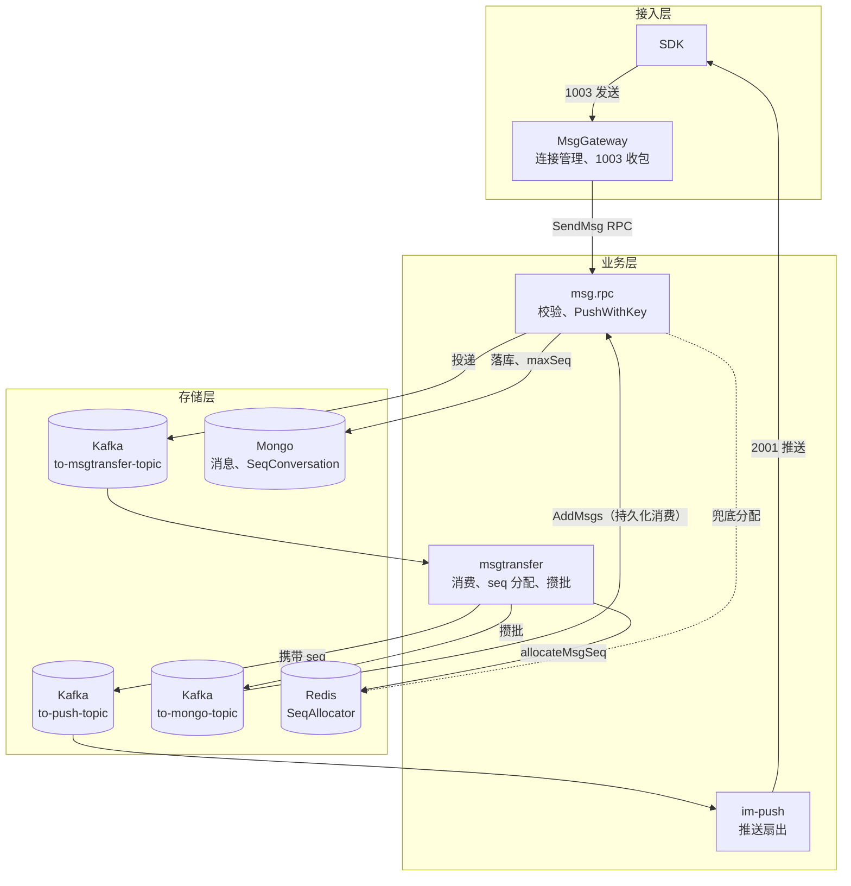
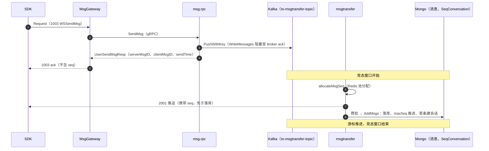
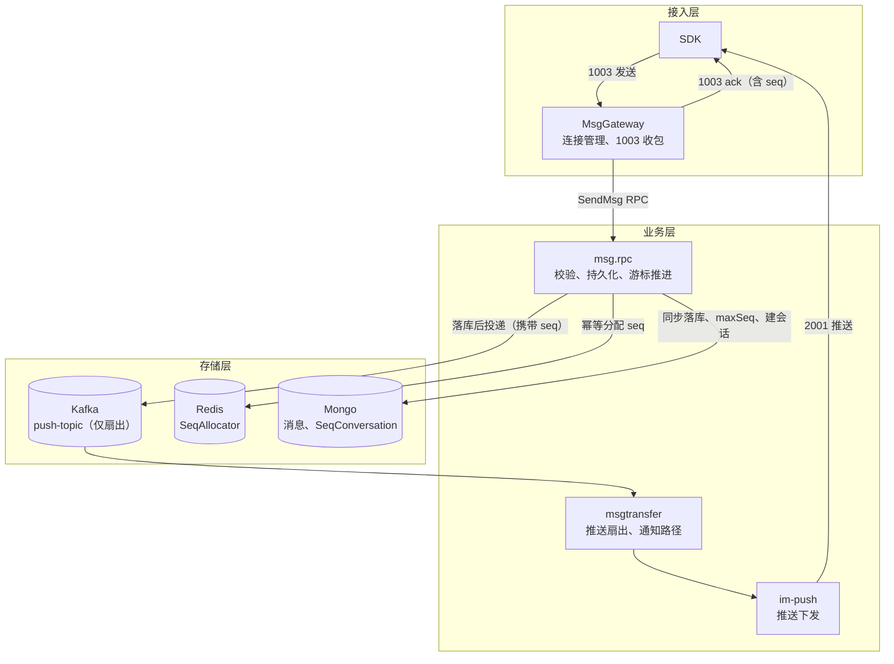
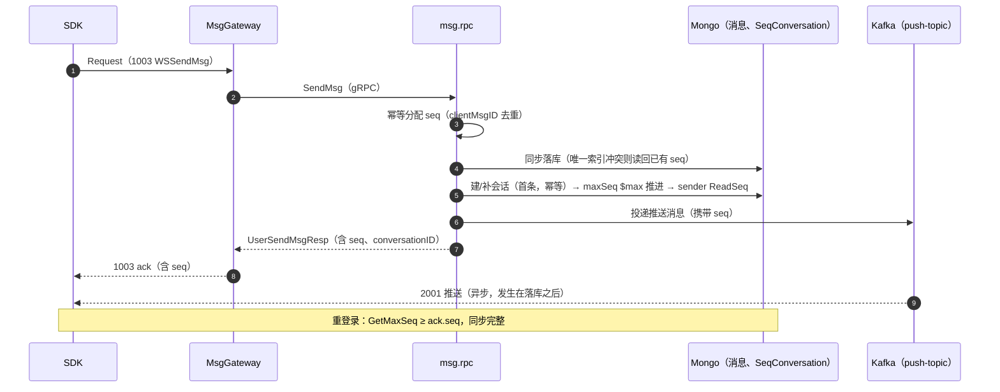

# 消息发送链路一致性改造设计文档：ack 前同步提交

1003（WSSendMsg）发送链路存在「ack 已返回、消息未可查」的竞态：网关回 ack 时消息尚未分配 seq、未落库、游标未推进，重登录用户可能同步不到已 ack 的消息。本文档给出改造设计——将 seq 分配、落库、游标推进前移到 ack 之前的同步路径，推送扇出保持异步。

---

## 一、设计概述

### 1.1 范围

覆盖：1003/1004 用户消息（单聊、群聊）的发送持久化路径，涉及 im-msggateway、im-rpc/msg、im-msgtransfer、pkg/storage、pkg/protocol 五个模块。

不覆盖：离线推送（APNs/厂商通道）可靠性模型、多机房一致性、通知消息（notification）与 typing 等不落库消息的处理方式。以上维持现状。

### 1.2 术语

| 术语 | 含义 |
|---|---|
| ack | 网关对客户端 1003 发包的响应（errCode=0 表示受理成功） |
| seq | 会话内消息序号，由 Redis SeqAllocator 池分配，单调递增 |
| NewestSeq（游标） | Mongo SeqConversation.maxSeq，同步接口据此判断客户端缺口 |
| 同步提交（写通） | 在返回 ack 前完成 seq 分配、落库、游标推进 |
| 竞态窗口 | ack 返回时刻与游标推进时刻之间的时间区间 |
| 空洞 | 已分配 seq 对应的消息因故障未落库，形成永久缺失的序号 |
| 攒批 | msgtransfer 将消息按会话聚合成批再写二级 MQ 的机制 |

### 1.3 问题定义与设计目标追溯

本文档无正式 PRD 上游，需求基线为对现状链路的问题分析（第二章）。四个问题与设计目标的对应关系：

| 编号 | 问题 | 设计目标 |
|---|---|---|
| P1 | 重登录同步缺失：ack 后立刻重登录，游标不含该消息，推送若丢失则消息要等下次重登录才出现 | G1 ack 返回 ⇒ 消息已落库且游标已推进 |
| P2 | 静默丢失：Kafka 投递成功即回 ack，消费链路故障时发送方无感知 | G2 落库失败对发送方显式可见，可重发 |
| P3 | 推送与可查性倒挂：push 先于落库，接收端凭 seq 补拉可能拉不到 | G3 推送发生在落库之后 |
| P4 | SDK 无法自愈：发送方不知道消息 seq，无法做状态机与缺口判断 | G4 ack 携带 seq |

### 1.4 约束

- 发送路径已包含 2~4 次同步 RPC（好友/黑名单校验、全局免打扰、会话查询），新增持久化步骤的延迟预算需控制在个位数毫秒量级 `[Data-backed]`（代码核实的现状 RPC 次数；延迟量级为估算，见 7.1）；
- 1003 ack 由网关在 RPC 返回后立即回复，网关本身不做持久化，改造不得把持久化职责下沉到网关 `[Expert judgment]`（保持网关无状态、可水平扩容的现有架构约束）；
- 改造需可灰度、可回滚，灰度期间新旧管道并存 `[Expert judgment]`。

---

## 二、现状架构与问题分析

### 2.1 现状架构

图 2-1 现状发送链路架构。msg.rpc 在发送路径上只做校验和 Kafka 投递；seq 分配、落库、游标推进全部发生在 msgtransfer 消费侧，其中持久化消费（K3 → AddMsgs）绕经 msg.rpc 的持久化接口完成。

各组件职责与边界：

| 组件 | 职责（现状） | 依赖 |
|---|---|---|
| MsgGateway | 连接管理、1003 收包、调 SendMsg、回 ack | msg.rpc |
| msg.rpc | 消息校验（好友/黑名单/免打扰）、PushWithKey 投递；另暴露 AddMsgs 供持久化消费调用 | Kafka producer、Mongo、Redis |
| msgtransfer | 消费 to-msgtransfer-topic：分配 seq、投 push topic、攒批投 mongo topic、二次消费调用 AddMsgs | Kafka consumer/producer、Redis |
| im-push | 消费 push topic，经网关下发 2001 | msg.rpc（推送 RPC） |

### 2.2 现状发送时序

图 2-2 现状发送时序。步骤 4 的 ack 返回时，图中 5~7 尚未发生；2001 推送（步骤 6）先于落库（步骤 7）。推送实际经 im-push 与网关转发到达 SDK，图中以 MT→C 一条箭头示意。

各步骤与代码位置的对应关系（均可从仓库核实）：

| 步骤 | 代码位置 | 同步/异步 |
|---|---|---|
| 网关收 1003，RPC 调 SendMsg | [message_handler.go](../im-msggateway/internal/message_handler.go) `handleSendMsg` | 同步 |
| msg.rpc 校验后 PushWithKey 即返回 | [message_logic.go](../im-rpc/msg/internal/logic/message_logic.go) `Logic.SendMsg` / `sendSingleChatMsg` | 同步（仅到 broker ack） |
| 网关回 1003 ack | [sdkws.proto](../pkg/protocol/sdkws/sdkws.proto) `UserSendMsgResp`（不含 seq） | — |
| seq 消费侧分配 | [handler.go](../im-msgtransfer/handler.go) `allocateMsgSeq` | 异步 |
| push 先于落库 | [handler.go](../im-msgtransfer/handler.go) `consumeMsg`：先 `toPushTopic` 后 `batcher.Push` | 异步 |
| 攒批 → 二级 MQ → AddMsgs 落库 + maxSeq + 建会话 + sender ReadSeq | [message_logic.go](../im-rpc/msg/internal/logic/message_logic.go) `AddMsgs` | 异步 |
| 1001 GetMaxSeq 读 Mongo SeqConversation | [seq_logic.go](../im-rpc/msg/internal/logic/seq_logic.go) `GetMaxSeq` | — |

### 2.3 竞态窗口

ack 返回时刻存在四个事实，共同构成竞态窗口 `[Data-backed]`（均对应 2.2 节代码定位）：

1. 消息尚未分配 seq——发送方无从得知自己消息的 seq；
2. 消息未落库——距可查还隔着 Kafka hop、消费延迟、攒批 flush 间隔、二级 MQ、Mongo insert，窗口量级在数十至数百毫秒；
3. 游标未推进——1001 GetMaxSeq 读不到该消息；
4. 首条消息时会话未创建——GetMaxSeq 依赖 GetConversationIDs，新会话整体不可见。

ack 语义应满足的三层，现状只满足第一层：

| 层级 | 语义 | 现状 |
|---|---|---|
| L1 | ack ⇒ 持久化已受理（消息进入 Kafka 且 broker 已确认） | 满足 |
| L2 | ack ⇒ seq 已分配且发送方可感知 | 缺失 |
| L3 | ack ⇒ 消息可查（落库完成、游标推进、会话存在） | 缺失 |

现状失败语义：Kafka 投递成功后，消费链路任何环节失败（毒消息、transfer 崩溃、Mongo 故障、攒批丢弃）都表现为「已 ack 但消息永不落库」，发送方无感知；这是 P2 的直接来源。

---

## 三、方案对比与选型

### 3.1 行业模式对照

IM 发送链路的一致性设计在业界收敛为三种模式：

| 模式 | ack 语义 | seq 分配位置 | 游标推进 | 代表系统 |
|---|---|---|---|---|
| 写通 | 主存储写成功才 ack | 写入路径同步分配，与消息原子绑定 | 写入时同步推进 | Discord、Slack、Matrix `[Research-backed]` |
| 序列先行 | ack = 进入可靠序列通道 | 独立 sequence 服务同步分配 | 通道本身持久化，游标随通道推进 | 微信、Signal `[Research-backed]` |
| 入队即 ack | broker ack 即成功 | 消费侧分配 | 消费落库后推进 | goim / OpenIM 现状 |

写通模式的公开依据：Discord API 写入存储成功后返回消息对象、gateway 广播异步（官方工程博客 *How Discord Stores Billions of Messages*）；Slack `chat.postMessage` 写入主存储后返回 `ts`；Matrix Synapse（开源）发送事件时同步写事件存储与 stream ordering。序列先行模式的公开依据：微信将 seq 做成独立 Sequence 服务、消息按 seq 进入写扩散队列，可靠性建立在 seq 通道本身持久化之上；Signal 写入 per-device 持久 mailbox 后才 ack。goim/OpenIM 同构的「消费侧分配 seq」结构，社区同样反馈过发送后立即查询或重登录丢消息的问题。`[Research-backed]`（上述来源均为厂商公开资料或可查源码）

### 3.2 候选方案

**方案 A：同步提交后 ack。** seq 分配、落库、建会话、游标推进全部前移到 msg.rpc SendMsg 同步路径；MQ 只承担推送扇出。对应行业「写通」模式。

**方案 B：seq 进 ack，落库仍异步。** seq 分配前移并随 Kafka 消息携带，ack 返回 seq；SDK 增加「ack.seq 未出现在 NewestSeq 前视为 pending」的有界等待。落库、游标推进仍在消费侧。

| 维度 | 方案 A | 方案 B |
|---|---|---|
| ack 语义 | 持久化完成 + 可查（L1~L3 全满足） | 已入 Kafka，seq 已知（L1+L2） |
| P1 重登录完整性 | 服务端保证 | 依赖各端 SDK 实现 pending 等待 |
| P2 消费失败后果 | 发送方可见，可重发 | 已 ack，静默丢失风险仍在 |
| P3 推送倒挂 | 消除 | 消除 |
| P4 SDK 改动 | 不需要（ack 带 seq 为增益） | 全平台必改 |
| REST/历史接口一致性 | 一致 | 仍有窗口 |
| 发送延迟 | +Redis 分配 + Mongo insert | +Redis 分配 |
| 管道复杂度 | 简化（落库攒批、二级 topic 退役） | 不变 |

### 3.3 选型结论

采用方案 A `[Expert judgment]`。理由：发送路径现状已含多次同步 RPC，追加一次 Redis 分配与一次 Mongo insert 的边际成本可控（见 7.1），换来 G1/G2 在服务端单侧成立、不欠 SDK 的债；方案 B 把一致性责任转嫁给 SDK 且 REST 查询仍有窗口，仅适合作为紧急止血的过渡。微信式「序列先行」需要把 MQ 升级为可查询的 seq 通道，改造面与运维复杂度高，与当前以 Mongo 为查询源的架构不匹配。

---

## 四、目标架构设计

### 4.1 目标架构

图 4-1 目标架构。持久化职责从 msgtransfer 收敛到 msg.rpc 发送路径；msgtransfer 对用户消息只保留推送扇出，通知消息路径不变。to-push-topic 与 to-mongo-topic 合并为单一 push-topic，落库攒批与 mongo topic 退役。

职责与边界变化：

| 组件 | 变化 | 变化后职责 | 不变 |
|---|---|---|---|
| msg.rpc | 新增：seq 幂等分配、同步落库、建会话、游标推进、sender ReadSeq；从 AddMsgs 抽取共享持久化方法 | 发送路径的持久化唯一入口 | 校验逻辑；AddMsgs 接口保留（消费侧兜底与通知路径） |
| msgtransfer | 退役：allocateMsgSeq（对用户消息）、攒批、mongo topic、持久化消费 | 消费 push topic 扇出推送；通知消息维持原路径 | 消费者伸缩模型 |
| MsgGateway | ack 响应新增 seq、conversationID 字段透传 | 无持久化职责 | 无状态扩容模型 |
| im-push | 无变化 | 推送下发 | — |

依赖方向保持无环：接入层 → 业务层 → 存储层；业务层内部 msgtransfer → im-push 单向。

### 4.2 目标发送时序

图 4-2 目标发送时序。步骤 3~5 全部完成后才发生步骤 6 的投递与步骤 7~8 的 ack，因此 ack 返回时 L1~L3 同时成立（G1）。推送实际经 im-push 与网关转发，图中以 MQ→C 一条箭头示意；推送可能晚于 ack 到达，SDK 以 seq 去重即可（G3、G4）。

### 4.3 关键设计决策

| 编号 | 决策 | 理由 | 依据 |
|---|---|---|---|
| D1 | seq 分配前移到 SendMsg 同步路径 | seq 与消息原子绑定是行业写通模式的基础；消费侧分配导致发送方永远不知道 seq，P4 无法解决 | `[Expert judgment]` |
| D2 | 落库同步、推送异步 | G1/G2 要求 ack 前落库；推送是 best-effort，行业共识为「实时性靠推送、完整性靠同步」 | `[Research-backed]` |
| D3 | 游标沿用 `$max` 单调推进 | SetConversationMaxSeq 已用 `$max` 原子更新，同步化后并发乱序不会导致游标回退，无需改造 | `[Data-backed]`（[seq_conversation.go](../pkg/storage/mongo/seqconversation/seq_conversation.go)） |
| D4 | 一期不引入「连续提交水位线」 | 同步落库乱序仅产生毫秒级临时空洞，客户端缺口补拉可收敛；水位线增加 Redis Lua 状态机复杂度，收益有限 | `[Expert judgment]` |
| D5 | 通知消息、typing 保持异步 | 不参与 ack 语义，不占 seq，无需同步路径延迟 | `[Expert judgment]` |
| D6 | 不设双路径开关，发送路径一次性切换为同步提交 | 开发阶段无线上流量，双路径并存只增加实现与测试面，无对应收益 | `[Expert judgment]` |

---

## 五、模块与接口设计

### 5.1 改造点清单

| # | 改造点 | 位置 | 对应目标 |
|---|---|---|---|
| 1 | UserSendMsgResp 增加 seq、conversationID 字段 | [sdkws.proto](../pkg/protocol/sdkws/sdkws.proto) | G4 |
| 2 | SendMsg 同步路径重写：校验 → seq 幂等分配 → 落库 → 建会话 → maxSeq → sender ReadSeq → 投递 push → 返回 | [message_logic.go](../im-rpc/msg/internal/logic/message_logic.go) `Logic.SendMsg` | G1~G4 |
| 3 | 从 AddMsgs 抽取共享持久化方法（建会话、BatchInsert、maxSeq、ReadSeq），同步路径与消费侧兜底复用 | 同上 `AddMsgs` | G1 |
| 4 | (conversationID, clientMsgID) 唯一索引与冲突读回逻辑 | MsgModel / Mongo 索引 | G2 |
| 5 | 用户消息由 msg.rpc 直接投递 push topic 并携带已分配 seq；通知消息维持原路径，seq 消费侧分配 | [handler.go](../im-msgtransfer/handler.go) | G1 |
| 6 | 用户消息的攒批 / mongo topic / 持久化消费退役（通知路径保留） | [handler.go](../im-msgtransfer/handler.go)、[msgtransfer.yml](../im-msgtransfer/etc/msgtransfer.yml) | — |
| 7 | （可选）SDK 记录 ack.seq、2001 去重排序 | 各端 SDK | G4 |

### 5.2 对外接口变更：UserSendMsgResp

| 字段 | 类型 | proto 序号 | 状态 | 语义 |
|---|---|---|---|---|
| serverMsgID | string | 1 | 现有 | 服务端消息 ID |
| clientMsgID | string | 2 | 现有 | 客户端消息 ID，幂等键组成部分 |
| sendTime | int64 | 3 | 现有 | 发送时间戳 |
| seq | int64 | 4 | 新增 | 会话内消息序号；客户端据此去重、做缺口判断 |
| conversationID | string | 5 | 新增 | 会话 ID |

错误响应（errCode 非 0）沿用现有错误码体系，与本设计直接相关的：`ErrCodeDatabaseError = 90002`（落库失败）`[Data-backed]`（[errx_code.go](../pkg/apiresp/errx/errx_code.go)）；校验类错误码不在本设计范围内。

兼容性：仅追加字段，旧版本客户端忽略未知字段，新旧客户端可混跑 `[Research-backed]`（protobuf 官方向后兼容性保证）。网关侧 errCode=0 时透传 resp 原文，不感知新增字段。

### 5.3 内部契约：幂等持久化

| 契约项 | 约定 |
|---|---|
| 幂等键 | (conversationID, clientMsgID)，Mongo 唯一索引 |
| 冲突语义 | insert 命中 E11000 时按幂等键读回已有文档，取其 seq 与 serverMsgID 按成功返回 |
| seq 分配与冲突的关系 | 冲突场景下已分配的 seq 不回滚，形成空洞（见 6.3） |
| RPC 重试 | 网关对 SendMsg 的重试携带相同 clientMsgID，命中幂等键后返回相同结果 |
| 失败返回 | 任一持久化步骤失败 → RPC 返回 90002，网关回 1003 errCode 非 0，SDK 判定发送失败 |

### 5.4 push topic 消息契约变化

用户消息不再经过 to-msgtransfer-topic，由 msg.rpc 直接投递 push topic 并携带已分配 seq；通知消息维持原路径，seq 由消费侧 allocateMsgSeq 分配。两条路径各自自洽，消费侧无需兜底分支。

---

## 六、数据设计

### 6.1 涉及的存储对象与变更

| 对象 | 存储 | 变更 |
|---|---|---|
| 消息文档（MsgModel） | Mongo | 新增唯一索引 (conversationID, clientMsgID) |
| SeqConversation.maxSeq | Mongo | 无结构变更，沿用 `$max` 单调推进 |
| SeqAllocator | Redis | 无变更（池分配、Lua 原子） |
| Kafka topic | Kafka | 用户消息路径合并为单一 push-topic；to-mongo-topic 对用户消息退役 |

### 6.2 一致性规则

- 不变量 I1：游标可见 ⇒ 消息可查。maxSeq 仅在对应消息 insert 成功后由同一路径推进，任何时刻 1001 + 1002 拉取不会越过已持久化内容（G1 的形式化表述）；
- 不变量 I2：游标单调。`$max` 更新保证并发写不回退；
- 不变量 I3：推送后置。push-topic 消息由落库成功之后的代码路径产生，推送携带的 seq 一定可拉取（G3）；
- 会话与消息的顺序：落库 → 建会话（幂等）→ maxSeq 推进，三者同路径完成，避免「消息已落库但 GetConversationIDs 不含该会话」的窗口。

### 6.3 空洞

三类来源与对策：

| 来源 | 时机 | 对策 |
|---|---|---|
| 幂等冲突 | insert 命中唯一索引，新分配的 seq 弃用 | 频率等于重发率，量级可忽略；计入空洞监控基线 |
| 进程崩溃 | seq 分配后、insert 前崩溃 | 现状消费侧同样存在（allocateMsgSeq 后崩溃），非新增风险；客户端约定补拉连续 N 次为空视为已删；allocated 水位与 maxSeq 差值告警 |
| 落库失败重试 | 90002 后 SDK 重发走新 seq | 失败路径由 SDK 显式重发，旧 seq 弃用，同上计入监控 |

空洞监控见 7.3；可选在 im-cron 增加对账任务（allocated 水位与 Mongo maxSeq 差值持续增长时告警），一期可选。

---

## 七、非功能设计

### 7.1 延迟

新增步骤的成本估算 `[Hypothesis]`（未实测，需在阶段一压测校准）：

| 步骤 | 估算 |
|---|---|
| Redis seq 分配（Lua 池分配，摊薄后） | 约 1ms |
| Mongo 单条 insert（含唯一索引校验） | 约 2~10ms |
| 首条消息建会话 RPC | 仅 seq==1 触发，稳态为零 |

总体 ack P99 预计增加个位数毫秒。验收标准：压测 1003 ack P99 增幅不超过基线的 20%，超出则复核 Mongo 容量（见 7.2）。

### 7.2 容量与热点

Mongo 单条写从消费侧搬到发送路径后，消息集合的写入压力总量不变（仍是每条消息一次 insert），变化在于写入方从「攒批批量写」变为「逐条写」，批量合并的收益消失 `[Expert judgment]`。需要评估的基准是目标发送 QPS 与 Mongo 副本集/分片的写能力，该数据未在本设计输入中提供，列为开放问题（9.2）；若逐条写成为瓶颈，备选路径是网关侧按会话微批聚合后再调 RPC，一期不实现。

### 7.3 可观测性

| 指标 | 对应目标 | 说明 |
|---|---|---|
| 1003 ack P99 / 错误率 | G1、G2 | 错误率上升主要来自 90002 显式化 |
| 落库错误率（90002 占比） | G2 | Mongo 写入健康度 |
| seq 空洞差值：allocator allocated 水位 − Mongo maxSeq | 6.3 | 持续增长告警 |
| 重登录同步完整率：发送后 N 秒内 GetMaxSeq(conv) ≥ ack.seq | G1 | 端到端一致性验收指标，N 取 5s 起步 `[Hypothesis]` |

---

## 八、影响与迁移

### 8.1 变更影响面

| 影响项 | 说明 |
|---|---|
| 协议 | UserSendMsgResp 追加字段，旧客户端兼容（见 5.2） |
| msg.rpc 发送路径 | 重写为同步持久化，新增共享持久化方法 |
| msgtransfer | 用户消息的落库攒批与 mongo topic 退役；通知路径不变 |
| SDK | 无必改项；可选利用 ack.seq 做去重与状态机 |
| 存储 | 新增唯一索引（需评估大集合建索引策略，见 9.2） |

### 8.2 分期步骤

1. **阶段一（服务端实现）**：proto 字段扩展 → 唯一索引 → SendMsg 同步路径与共享持久化方法 → msgtransfer 用户消息管道退役（同一版本交付）；
2. **阶段二（验证与上线）**：端到端用例、故障演练、压测对比基线通过后上线；
3. **阶段三（增益）**：SDK 消费 ack.seq 做去重与状态机；（可选）cron 对账任务。

### 8.3 上线顺序

- 唯一索引先行（测试库直接创建，见 9.2 Q2），随后部署服务端二进制；
- proto 仅追加字段，客户端可后于服务端升级，无强制同步发布；
- 异常时回退版本即可，无数据回填需求。

---

## 九、风险与开放问题

### 9.1 风险

| 风险 | 影响 | 缓解 |
|---|---|---|
| Mongo 写入成为发送热点 | 发送 RTT 抖动 | 7.2 基准评估、慢查询监控、必要时分片；P99 增幅超 20% 回滚 |
| 大集合建唯一索引 | 建索引期间 IO 压力 | 采用 rolling build；评估集合规模后选择窗口 |
| 崩溃空洞 | 极端场景 seq 缺失 | 与现状同级风险；空洞容忍约定 + 差值告警（6.3） |
| 同步落库乱序 | 毫秒级临时空洞 | D4：客户端缺口补拉收敛；观察期后再决定是否引入水位线 |

### 9.2 开放问题

| 编号 | 问题 | 状态 |
|---|---|---|
| Q1 | 目标发送 QPS 与 Mongo 写能力基准，用于 7.2 容量结论 | 待提供数据 |
| Q2 | 测试库消息集合规模（量级小则直接创建索引；已有大规模数据时评估建索引窗口） | 待确认 |
| Q3 | 7.1 延迟估算的压测校准 | 阶段一执行 |
| Q4 | SDK 是否同步利用 ack.seq（涉及各端版本节奏） | 待产品确认 |
