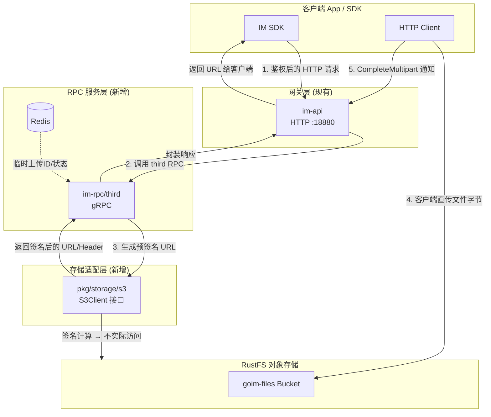
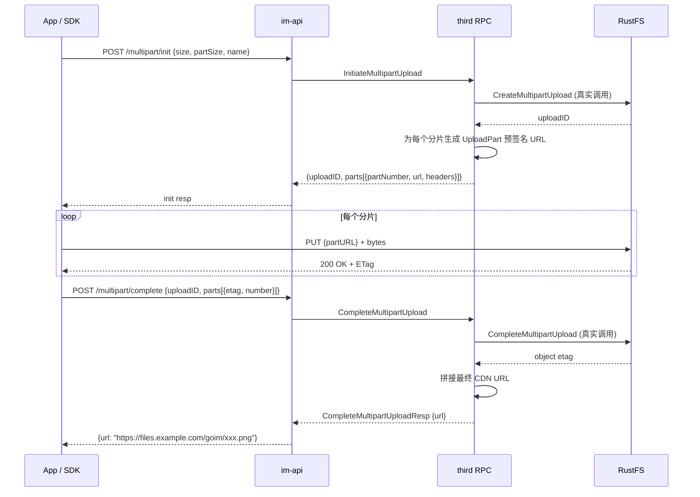
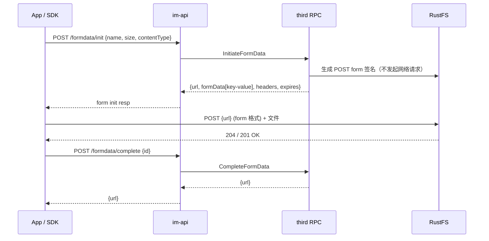

# 第三方存储集成 RustFS 技术设计文档

| 项 | 值 |
|----|----|
| 文档类型 | HLD + 接口设计 |
| 系统阶段 | Brownfield 扩展 |
| 复杂度 | Medium |
| 日期 | 2026-11-09 |

---

## 目录

1. [设计概述](#1-设计概述)
2. [系统架构](#2-系统架构)
3. [模块设计](#3-模块设计)
4. [接口设计](#4-接口设计)
5. [客户端 SDK 策略](#5-客户端-sdk-策略)
6. [非功能性设计](#6-非功能性设计)
7. [迭代计划](#7-迭代计划)
8. [风险与注意事项](#8-风险与注意事项)

---

## 1. 设计概述

### 1.1 目的与范围

本文档定义 goim 系统新增的第三方文件存储子系统。后端将通过 RustFS 提供的 S3 兼容协议，向外暴露文件上传、分片上传、下载访问等能力。文件数据不经过后端转发，客户端凭借后端颁发的预签名 URL 直接与 RustFS 通信。

文档聚焦于后端服务的架构、模块边界、接口契约与数据流，不包含业务消息（聊天、群组）本身的存储设计。后者已由 MongoDB 现有方案覆盖。

**明确包含**：S3/RustFS 适配层、third RPC 服务、im-api HTTP 转发层、配置规范。

**明确不包含**：文件内容在后端的实际字节代理上传、文件元数据持久化（文件 URL 由业务消息自行引用）、移动端 SDK 客户端实现细节。

### 1.2 设计目标

| 目标 | 描述 | 证据 |
|------|------|------|
| 与现有 proto 对齐 | 实现 `third.proto` 已定义的全部 RPC 语义，避免协议漂移 | Data-backed |
| 免代理上传 | 文件流量不经过后端服务，后端仅负责签名与鉴权 | Expert judgment |
| 存储可替换 | 适配层屏蔽 S3 协议细节，替换 MinIO / 阿里云 OSS / AWS S3 无需改业务层 | Expert judgment |
| 与 go-zero 架构一致 | 新 RPC 服务沿用现有 `logic → server → svc` 分层与 Etcd 注册 | Data-backed |

### 1.3 关键术语

| 术语 | 定义 |
|------|------|
| RustFS | Apache 2.0、Rust 编写的 S3 兼容对象存储，endpoint 默认 9000 端口 |
| 预签名 URL | 后端使用 AccessKey/SecretKey 对 S3 请求进行签名，得到携带临时权限的完整 URL，客户端在有效期内直接使用 |
| Multipart Upload | S3 分片上传协议：init → upload parts → complete，支持大文件断点续传 |
| FormData Upload | S3 POST form 上传，适用于中小文件一次性直传 |
| Path-style | S3 请求路径风格 `endpoint/bucket/key`；RustFS/MinIO 兼容此风格 |

---

## 2. 系统架构

### 2.1 架构概览

整体采用 **"后端签发 URL → 客户端直传 RustFS" 的免代理架构**。后端不接触文件字节，职责被严格压缩为三件事：鉴权、签名、记录上传结果。这种架构将后端带宽占用降到几乎为零，同时获得近乎与 RustFS 本身等同的上传吞吐。

### 2.2 架构图



**图 1：整体架构** — 粗箭头为控制流，虚线为 Redis 辅助状态，客户端直接把字节写入 RustFS。

架构关键点：

- **RPC 边界清晰**：third 服务只暴露 proto 定义的 RPC，不直接暴露 HTTP。HTTP 层由 im-api 统一承载。
- **适配层隔离**：`pkg/storage/s3` 是一个纯 Go 接口 + AWS SDK v2 实现。未来替换底层存储（例如 MinIO、OSS 兼容模式）仅需更换一个实现，业务层无感知。
- **im-api 转发**：现有 im-api 已经有 auth middleware，third RPC 调用通过 Etcd 服务发现路由。

### 2.3 技术选型与理由

#### RustFS 作为对象存储后端

Apache 2.0、S3 兼容、Go SDK 直接复用 AWS SDK v2。社区活跃，适合私有化部署场景。

> **Hypothesis** — 需实际验证预签名 POST、Multipart 兼容性。

#### AWS SDK v2 for Go 对接 RustFS 的 Go 语言 SDK

生态成熟、类型安全、与 `aws-sdk-go-v2/service/s3` 的 Presign 模块完美覆盖签名需求。RustFS 与 AWS S3 在预签名和 Multipart 两个最关键场景的 API 层面兼容。

> **Expert judgment**

#### 现有 go-zero 微服务框架

third RPC 服务沿用 auth/msg/group 等已有服务的模式，减少新服务的心智负担和部署脚本差异。Etcd 注册、service context 注入、middleware 复用。

> **Data-backed** — 项目已有 6 个相同模式的 RPC 服务

#### HTTP API 路由

新增 `im-api/internal/handler/third` 作为第三层 handler 模块，与 auth/msg/user/group/relation/conversation 已有 handler 对齐，减少 im-api 主入口的条件分支。

> **Data-backed**

---

## 3. 模块设计

### 3.1 模块清单与职责

| 模块 | 位置 | 单一职责 | 依赖 |
|------|------|---------|------|
| **S3 适配层** | `pkg/storage/s3/` | 把 S3 API 调用封装成 goim 内部语义（生成签名 URL、发起/完成分片上传、生成下载 URL） | AWS SDK v2 |
| **third RPC 服务** | `im-rpc/third/` | 按 proto 契约对外提供 `third.Third` gRPC 实现 | 适配层、Redis、config |
| **third RPC Client** | `pkg/rpcclient/thirdservice/` | 封装对 third RPC 的调用，屏蔽 gRPC stub 细节 | third.pb.go |
| **im-api third handler** | `im-api/internal/handler/third/` | 接收 HTTP 请求，鉴权后调用 third RPC | thirdservice、auth middleware |
| **配置** | `im-rpc/third/etc/third.yaml` + `im-api/etc/api.yml` | RustFS endpoint / credentials / bucket / 过期时间 / Etcd key | — |

### 3.2 S3 适配层接口

这是整个设计最核心的抽象边界。接口定义如下：

```go
// pkg/storage/s3/client.go

type S3Client interface {
    // 分片上传
    InitiateMultipartUpload(ctx context.Context, bucket, key, contentType string) (uploadID string, err error)
    GenerateUploadPartPresignedURL(ctx context.Context, bucket, key, uploadID string, partNumber int32) (url string, headers []http.Header, err error)
    CompleteMultipartUpload(ctx context.Context, bucket, key, uploadID string, completedParts []CompletedPart) (objectURL string, err error)
    AbortMultipartUpload(ctx context.Context, bucket, key, uploadID string) error

    // FormData 上传（单文件直传）
    GeneratePostFormPresignedData(ctx context.Context, bucket, key, contentType string) (PostFormResult, error)

    // 下载
    GenerateGetObjectPresignedURL(ctx context.Context, bucket, key string, expireSeconds int64) (string, error)

    // 管理
    DeleteObject(ctx context.Context, bucket, key string) error
    ListObjects(ctx context.Context, bucket, prefix string) ([]ObjectInfo, error)
    HeadObject(ctx context.Context, bucket, key string) (*ObjectInfo, error)
}
```

接口的语义刻意保持接近 `third.proto` 的 RPC 定义，这样 third RPC 的 logic 层几乎只是一层薄转换。

### 3.3 关键目录结构

```
# === 新增 ===
pkg/storage/s3/
  client.go           # S3Client 接口 + 配置结构
  client_s3.go        # AWS SDK v2 实现
  presign.go          # 预签名生成（Get/Put/UploadPart/PostForm）
  multipart.go        # InitiateMultipartUpload / CompleteMultipartUpload

im-rpc/third/
  third.go                              # main 入口（参考 im-rpc/auth/auth.go）
  etc/third.yaml                        # 服务配置
  internal/
    config/config.go                    # Config 结构（RustFS + Redis + Etcd）
    server/third_server.go              # gRPC server，每个 RPC → logic
    svc/service_context.go              # 注入 S3Client、Redis、Etcd 注册
    logic/
      logic.go
      part_limit_logic.go
      initiate_multipart_logic.go
      auth_sign_logic.go
      complete_multipart_logic.go
      access_url_logic.go
      initiate_formdata_logic.go
      complete_formdata_logic.go
      delete_outdated_logic.go
      fcm_update_token_logic.go         # stub（推送相关）
      set_app_badge_logic.go            # stub
      upload_logs_logic.go              # stub 或实现（日志上传也用 RustFS）
      delete_logs_logic.go              # stub
      search_logs_logic.go              # stub

pkg/rpcclient/thirdservice/
  thirdservice.go     # NewThirdService(cli) → 返回 ThirdClient 封装

im-api/internal/handler/third/
  third.go            # HTTP handler 实现
  routes.go           # InitRoutes(baseRoute, svc) 注册路由

# === 修改 ===
im-api/etc/api.yml                    # 新增 ThirdRpc 配置段
im-api/internal/svc/service_context.go # 新增 ThirdService 客户端
im-api/internal/handler/routes.go      # 注册 third.InitRoutes(...)
```

目录结构与项目已有模块（auth、msg、user）保持严格一致。新成员在不读文档的情况下，也能通过类比 auth 服务的目录推断出 third 的实现位置。

### 3.4 配置示例

```yaml
# im-rpc/third/etc/third.yaml
Name: third.rpc
ListenOn: 0.0.0.0:18885

Etcd:
  Hosts:
    - 127.0.0.1:2379
  Key: third.rpc

Redis:
  Host: 127.0.0.1:6379
  Pass: "123456"

# RustFS/S3 配置
RustFS:
  Endpoint: "http://127.0.0.1:9000"
  PublicEndpoint: "https://files.example.com"
  AccessKey: "rustfsadmin"
  SecretKey: "rustfsadmin"
  Region: "us-east-1"
  Bucket: "goim-files"
  UsePathStyle: true
  PresignExpire: 3600     # 预签名过期时间（秒）
  FormExpire: 1800        # POST form 签名过期时间
```

---

## 4. 接口设计

### 4.1 im-api HTTP API

对外暴露的 HTTP API 是 SDK 与 App 的直接调用面。所有调用都复用现有 `im-api` 的鉴权中间件（Bearer token）。

| 方法 | 路径 | 描述 | 对应 RPC |
|------|------|------|----------|
| GET | `/api/v1/third/part_limit` | 获取分片上传限制 | `PartLimit` |
| POST | `/api/v1/third/multipart/init` | 初始化分片上传，返回 uploadID 和各分片的预签名 URL | `InitiateMultipartUpload` |
| POST | `/api/v1/third/multipart/sign` | 按分片号列表请求额外预签名 URL | `AuthSign` |
| POST | `/api/v1/third/multipart/complete` | 上传完成后通知后端合并分片 | `CompleteMultipartUpload` |
| POST | `/api/v1/third/formdata/init` | 初始化单文件直传（POST form） | `InitiateFormData` |
| POST | `/api/v1/third/formdata/complete` | 完成单文件直传后获取最终 URL | `CompleteFormData` |
| GET | `/api/v1/third/access_url` | 获取文件访问 / 下载 URL（带过期时间） | `AccessURL` |

### 4.2 接口契约示例

#### `POST /api/v1/third/multipart/init` — 初始化分片上传

| 字段 | 值 |
|------|----|
| **用途** | 客户端告诉后端：文件多大、打算分几片 → 后端返回 uploadID + 各分片的签名 URL |
| **鉴权** | Bearer token（复用 im-api 中间件） |
| **请求体** | `{"hash": "sha256", "size": 41943040, "partSize": 8388608, "name": "image.png", "contentType": "image/png", "urlPrefix": "https://files.example.com/goim/"}` |
| **成功响应** | `{"uploadID": "abc123", "partSize": 8388608, "parts": [{"partNumber": 1, "url": "https://...signed..."}, ...]}` |
| **错误** | 401 未授权，400 size/partSize 非法，500 RustFS 调用失败 |

#### `GET /api/v1/third/access_url` — 获取下载 URL

| 字段 | 值 |
|------|----|
| **用途** | 将 RustFS 内部 key 换取带签名的临时访问 URL |
| **查询参数** | `name`（string, 必填 — RustFS object key）, `millisecond`（int64, 可选 — 过期毫秒数，默认 3600s） |
| **成功响应** | `{"url": "https://files.example.com/...X-Amz-Signature=...", "expireTime": 1731200000}` |

### 4.3 核心流程时序图

#### 4.3.1 分片上传完整流程（大文件推荐）



**图 2：Multipart Upload 完整流程**。后端只参与 init 和 complete 两次，分片字节全部由 App 与 RustFS 直接交换。

#### 4.3.2 表单上传（中小文件，≤ 32MB 推荐）



**图 3：FormData 单文件直传**。一次 HTTP 调用搞定整个文件，适合头像、语音等 ≤ 32MB 场景。

---

## 5. 客户端 SDK 策略

### 5.1 后端职责

在免代理架构下，后端职责被压缩为两件事：

1. **生成预签名 URL** — 使用 AccessKey/SecretKey 对 S3 请求签名。签名算法本身由 AWS SDK v2 提供。
2. **鉴权 + 限流** — 复用 im-api 现有中间件。

后端不会看到文件字节。上传成功与否由 RustFS 自己确定，后端只在 CompleteMultipartUpload 或 CompleteFormData 时被通知。

### 5.2 客户端职责

| 职责 | 由谁负责 |
|------|---------|
| 计算文件 hash（可选但推荐用于校验和幂等） | App / SDK |
| 按 PartLimit 把文件切成分片 | App / SDK |
| 并发上传分片（HTTP PUT 到预签名 URL） | App / SDK |
| 分片重试 + 断点续传 | App / SDK |
| 并发度控制（避免打爆 RustFS） | App / SDK |
| 完成上传后通知后端合并 | App / SDK |

### 5.3 SDK 是否需要集成？

**可选，非必须**。后端已经把上传流程拆成了 3 个 HTTP API 调用 + N 次到 RustFS 的 HTTP PUT。任何具备 HTTP client 的客户端（移动 SDK、Web SDK、桌面 App）都能独立完成上传。

> **推荐实践**：SDK 封装 "init multipart → upload parts with concurrency → complete" 这一完整流程，内部处理分片大小、并发度、重试、hash 校验等繁琐细节。App 层只调用一个 `uploadFile(file) → URL` 方法即可。但如果团队不想引入 SDK 依赖，App 也可以直接调用 HTTP API。

不强制集成的原因：

- 预签名 URL 是一个普通的 HTTPS URL，无需任何 RustFS 专属客户端库就能 PUT 上去。
- 多端 SDK 由不同团队（iOS/Android/Web）维护，强行统一可能引发发布节奏冲突。
- 如果将来更换对象存储后端，SDK 层只需要改 URL 获取逻辑，上传部分的 HTTP PUT 不变。

---

## 6. 非功能性设计

### 6.1 性能

由于后端不转发文件字节，性能瓶颈由 RustFS 的网络带宽与客户端到 RustFS 的链路质量共同决定。后端侧的 QPS 主要由 Initiate / AuthSign / Complete 这几个控制类 RPC 构成，**后端的压力接近于纯 RPC 调用的轻量级负载**。

可以通过控制 `PresignExpire`（默认 1 小时）来平衡安全性与 URL 复用率。如果客户端频繁重申请签名，适当延长过期时间能降低后端 QPS。

### 6.2 安全性

- RustFS AccessKey/SecretKey 仅保存在 third RPC 服务的配置文件中。不会泄露给客户端。
- 预签名 URL 自带过期时间，过期后自动失效。
- 预签名 URL 的 `policy` 字段（FormData）或 `x-amz-signedheaders`（Multipart）可以进一步锁定 Content-Type、文件大小范围等约束，防止客户端上传非预期内容。
- im-api 层的 Bearer token 鉴权确保只有登录用户能申请签名 URL。

### 6.3 可用性

third RPC 服务是无状态的（签名计算不依赖持久化状态），天然支持水平扩展。当 RustFS 短暂不可用时，third RPC 的 `InitiateMultipartUpload` 与 `CompleteMultipartUpload` 会直接失败并向上返回错误码。适配层应当对 S3 客户端调用加入超时和重试（AWS SDK v2 自带 retry middleware）。

---

## 7. 迭代计划

| 迭代 | 内容 |
|------|------|
| **Iteration 1** — S3 适配层 | `pkg/storage/s3/` 接口 + AWS SDK v2 实现；本地单元测试 + mock S3Client；在本地 RustFS 上跑一遍兼容测试（multipart、presign、post form） |
| **Iteration 2** — third RPC 骨架 + FormData | `im-rpc/third/` 完整脚手架；Etcd 注册 + service context 注入 S3Client；InitiateFormData + CompleteFormData 两端打通 |
| **Iteration 3** — Multipart Upload 全链路 | PartLimit / Initiate / AuthSign / Complete；im-api HTTP handler 路由注册；端到端 E2E 测试 |
| **Iteration 4** — 访问 URL + 清理任务 | AccessURL 下载签名接口；DeleteOutdatedData 接入 im-cron 定时任务；推送 / 日志相关 RPC stub 策略最终定稿 |

> **⚠️ 关键前置**：Iteration 1 完成后，务必先在本地 RustFS 上跑一轮 S3 API 兼容性测试，确认 `CreateMultipartUpload`、`UploadPart` 预签名、`CompleteMultipartUpload`、POST form 签名四个关键场景全部通过。RustFS 不是 100% AWS S3 等价，任何一个场景不兼容都需要在适配层进行 workaround。

---

## 8. 风险与注意事项

### 8.1 RustFS S3 兼容性验证

RustFS 官方明确声明"不是完全等价于 AWS S3 或 MinIO"。以下 API 需要重点验证：

| API | 风险点 | 验证手段 |
|-----|--------|---------|
| `CreateMultipartUpload` | 返回的 uploadID 格式是否被 Complete 端接受 | 编写最小 Go 测试程序 |
| `UploadPart` 预签名 | 签名 header 是否包含 `Content-Length` 约束 | curl 实测 |
| POST form 签名 | policy 字段格式是否兼容 MinIO / AWS | 最小 Go 测试程序 |
| `CompleteMultipartUpload` | ETag 聚合逻辑与 AWS 是否一致 | 用 AWS SDK 直接跑通流程 |
| Path-style 支持 | `endpoint/bucket/key` vs `bucket.endpoint/key` | 配置 `UsePathStyle: true` |

### 8.2 与现有 OpenIM 体系的差异

原版 OpenIM 有一个完整的 third 服务（Go 实现），它支持多种存储后端（MinIO、阿里云 OSS、腾讯云 COS、AWS S3、七牛云、本地存储）。goim 目前只引入了 `third.proto` 协议层，未引入其服务实现。

我们的设计选择 **只支持 RustFS 这一个后端**，通过适配层接口保留未来扩展的可能性。这样做比复制一整份 OpenIM 的 third 实现更轻量、更可控。

### 8.3 推送与日志 RPC 的处理

`third.proto` 中还定义了 FCM token 更新、App badge 设置、日志上传/删除/搜索等 RPC。这些功能在当前迭代中暂不实现，RPC 服务中对应 handler 返回空响应或 "stub not implemented" 错误码。后续根据实际需求再逐个接入。

### 8.4 URL 暴露路径

客户端拿到的是 RustFS 的真实 endpoint 吗？如果 RustFS 部署在内网，客户端直传时会连不上。推荐在 RustFS 前面加一层 nginx/Caddy 做反代，客户端连的是公网域名（如 `files.example.com`），后端配置里 `PublicEndpoint` 就是这个域名。后端签名时用 public endpoint，RustFS 本身的 endpoint 只在后端内部访问。

---

*文档版本 v1.0 · 2026-11-09*
